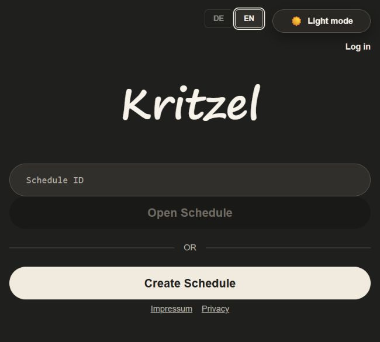

# Kritzel

[](https://github.com/Robertsvg/kritzel/actions/workflows/checks.yml)

A self-hosted appointment-polling application built with TypeScript,
[UIX](https://github.com/unyt-org/uix), and DATEX. Create a poll, share a
participant link, and compare availability without requiring an account.



## Features

- Date and time-slot polls with configurable voting options.
- Live configuration and vote updates through DATEX.
- Voting deadlines, weighted best-slot suggestions, and per-slot comments.
- Daily, weekly, and monthly follow-up rounds.
- iCalendar export and local busy-slot import.
- Optional accounts with a personal survey list.
- German/English controls, persistent light/dark themes, and keyboard support.
- Expired-survey cleanup and separate editor/participant links.

## Run Locally

This application uses **Deno for UIX**, the runtime distributed by unyt.
The full application requires that runtime; a standard Deno installation is
sufficient for the isolated logic tests. Follow the
[official installation instructions](https://docs.unyt.org/manual/uix/getting-started).
The verified combination is Deno for UIX 2.2.7, UIX 0.4.39, and DATEX 0.3.15.

After installing the UIX runtime:

```bash
git clone https://github.com/Robertsvg/kritzel.git
cd kritzel
deno task dev
```

Open <http://localhost:8080>. The first launch downloads framework dependencies
and initializes local DATEX state. Keep that generated state private; it is
excluded from Git. To use a different port, run `deno task dev 8081`.

## Development

```bash
deno task test
deno task lint
deno task fmt:check
```

The test suite covers framework-independent scheduling, calendar, password,
session, and rate-limit logic. Full UIX/DATEX integration also needs a live
runtime; unit tests do not establish full application coverage.

## Layout

```text
backend/           Survey endpoints, authentication, and server bootstrap
backend/security/  Password hashing and session validation
common/            Shared models, schedule logic, calendar helpers, components
frontend/          Routes, pages, and browser session state
docs/              Architecture, development, and deployment notes
app.dx             UIX application metadata
importmap.json     Public framework and local import mappings
```

See [architecture](docs/architecture.md) for the data flow and
[development](docs/development.md) for test scope and deployment configuration.

## Background

Maintained as a standalone portfolio edition by
[Yousef Mousa](https://github.com/Robertsvg). Based on the Kritzel application
and the merged TU Berlin team project, originally developed in the
[Institut fuer Digitale Lehre](https://digitalelehre.org) ecosystem.
Original contributors and vendored-library notices are retained in
[provenance](docs/provenance.md).
